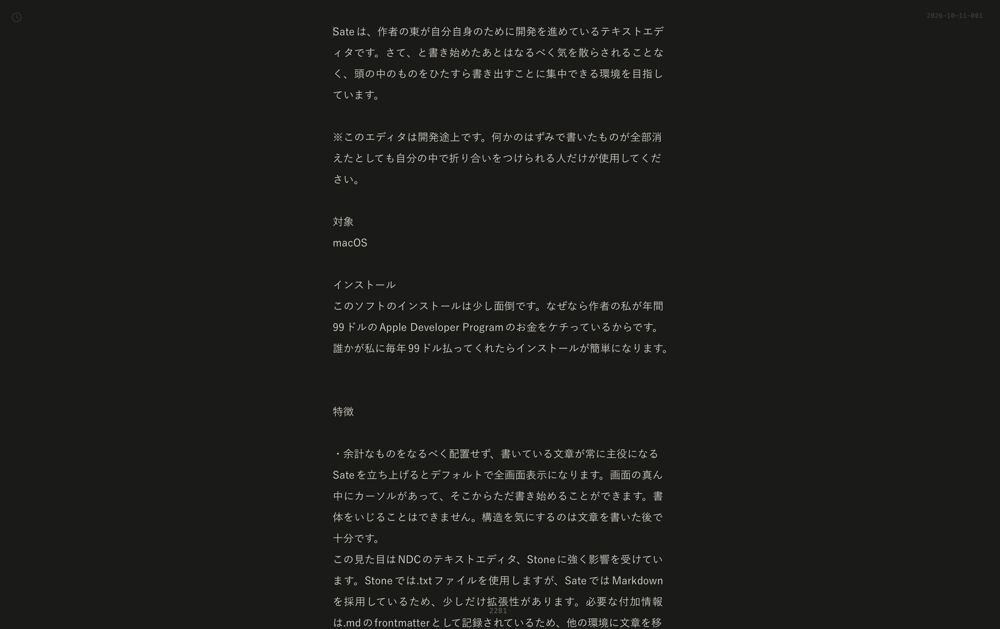
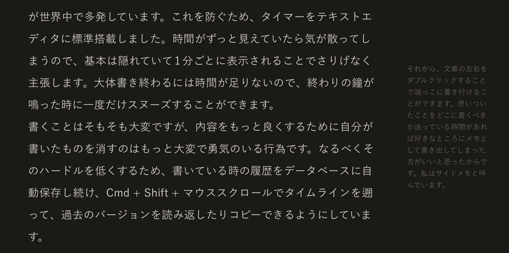

# Sate

> **あずまさんによるテキストエディタSateのWindows移植版です**
>
> [Windows版のダウンロード（Releases）](https://github.com/na-gasena/sate-win/releases/latest) のAssetsから `Sate_0.1.0_x64-setup.exe` でインストールしてください。


Sateは、あずま(@sngazm)さんが自分自身のために開発しているテキストエディタです。さて、と書き始めたあとはなるべく気を散らされることなく、頭の中のものをひたすら書き出すことに集中できる環境を目指しています。この文章はSateで書かれました。



※このエディタは開発途上です。破壊的変更やバグなど、何かのはずみで今まで書いたものが全部消えたとしても自分の中で折り合いをつけられる人だけが使用してください。

## 対象（Windows移植版）

Windows（x64／64bit）

## インストール

### Windowsインストーラー

[Releases](https://github.com/na-gasena/sate-win/releases/latest) のAssetsから `Sate_0.1.0_x64-setup.exe` をダウンロードして実行してください。ユーザー単位でインストールされます。

動作にはMicrosoft Edge WebView2 Runtimeが必要です。通常の利用にNode.jsやRustなどの開発用ツールは不要です。

### ソースからビルド

必要なもの: [Node.js](https://nodejs.org/) 22.18以上、[pnpm](https://pnpm.io/) 11、[Rust](https://rustup.rs/)（MSVCツールチェーン）、Visual Studio C++Build Tools（「C++によるデスクトップ開発」とWindows SDK）、Microsoft Edge WebView2 Runtime。

PowerShellで次を実行してください。

```powershell
git clone --branch windows https://github.com/na-gasena/sate-win.git
cd sate-win
pnpm install --frozen-lockfile
pnpm tauri build --bundles nsis
# 実行ファイル: src-tauri/target/release/sate.exe
# インストーラー: src-tauri/target/release/bundle/nsis/Sate_0.1.0_x64-setup.exe
```

開発用の起動方法などは [Windows版の開発・確認手順](docs/windows.md) を参照してください。

## 特徴


### 余計なものをなるべく配置せず、書いている文章そのものが常に対象になる

Sateを立ち上げるとデフォルトで全画面表示になります。画面の真ん中にカーソルがあって、そこからただ書き始めることができます。書体をいじることはできません。構造を気にするのは文章を書いた後で十分です。


SateではMarkdownを採用しているため、少しだけ拡張性があります。とはいえSateの中で書いている時にはファイルの形式を気にする必要はありません。文章の付加情報は.mdのfrontmatterとして記録されているため、いつでも他の環境に文章を移行することもできます。飽きても大丈夫ということです。

### ファイルシステムを意識せず、タイトルをつけずに書き終われる

私はこれから書く文章のタイトルを決めるようなことはしません。書いてみないとタイトルなどつけようもないし、タイトルを決めた時点で中身が制約されて書くことがつまらなくなってしまう気がするからです。しかし、多くのテキストエディタは最初の保存の段階で保存ダイアログが出現し、何も指定しなければ「無題」とか「Untitled-1」のような既定ファイル名をつけられ、どこに保存するかを指定する必要があります。まるでタイトルをつけないことが悪いことのようです。これは私にとって苦痛です。タイトルとファイル名が同じ概念だとロクなことがありません。ファイル名は重複を許さず、Finderで見た時の表示順も気になってきます。これは文章と全く関係のないことです。

Sateは最初から最後までタイトルをつける必要はありません。（つけたければ、1行目で↑キーを押すと、タイトルをつけることもできます。）Cmd + Oを打つと文章の一覧が出てきます。前に書いた文章を探したければそこで全文検索ができます。

タイトルとファイル名は別で、最初に新しい文章を開いた時点で「2026-10-11-001.md」のような、日付と連番ファイル名が自動的に設定されますが、この名前は基本的に気にする必要はありません。(まだ気になるので、ほとんど見えなくする予定です)

### 位置や順序を気にせずに自分に書くことを迫らせる仕組み

左上にはタイマーがあります。今15分に設定してオンにしました。鈴の音が鳴って、カウントダウンが始まります。書こうとしていたことを15分以内に書き出さなければならないというプレッシャーが自分自身に与えられます。ポモドーロ・テクニックでも有名なタイムボクシング法というもので、小さな時間に区切ることで他のことに思考が逸れるのを防ぎ、書くことを前に進めることができます。私にはこれが有効ですが、タイマーを動かすにはスマホを取り出す必要があります。そこでSNSを見始めたりしては本末転倒であり、実際そのような事故が世界中で多発しています。これを防ぐため、タイマーをテキストエディタに標準搭載しました。時間がずっと見えていたら気が散ってしまうので、基本は隠れていて1分ごとに表示されることでさりげなく主張します。大体思ったことを全部書き終わるには時間が足りないので、終わりの鐘が鳴った時に一度だけスヌーズすることができます。

書くことはそもそも大変ですが、内容をもっと良くするために自分が書いたものを消すのはもっと大変で勇気のいる行為です。なるべくそのハードルを低くするため、書いている時の履歴をデータベースに自動保存し続け、Cmd + Shift + マウススクロールでタイムラインを遡って、過去のバージョンを読み返したりコピーできるようにしています。



### 誰にも読ませない文章を書くための仕組み

土門蘭さんの『ほんとうのことを書く練習』という本に、誰にも読ませない文章を書き続けることがどれだけ重要かが語られています。私はほとんどその目的のためにSateを開発しています。それはなんとなく背景が暗かったり、UIやフォントが抑制的であったりするところにも現れているかもしれません。自分の部屋とか深夜のデニーズで、一人で誰にも読ませない文章を書くためのエディタです。

文章は自分のコンピュータの中のファイルなので、もちろん意図的に公開しない限りは(あるいは勝手にログインされたり覗き込まれない限りは)他人には見られませんが、意図せず画面に現れてしまうかもしれないと思うと、うかつに思ったことを書けなくなります。心理的安全性のため、右上からPrivateにチェックを入れた文章はCmd+Oの文章一覧や検索でも書き出しや中身が出てこないようになります。

### 公開コマンド追加機能

そう言った直後ですが、書いた文章を全世界に公開したくなる時があります。公開ボタンを用意して任意のコマンドを実行できるようにしておくので、そのボタンを押したら何が起こるかは、各々自分で作ってください。私は自分のテキストサイトの更新コマンドを叩くようにしています。何も設定しなければボタンも表示されません。

## 操作方法


| キー                                | 動作                      |
| --------------------------------- | ----------------------- |
| Ctrl + O                          | 文章の一覧・検索を開く／閉じる         |
| Ctrl + N                          | 現在の文章を保存して、新しい文章を作る     |
| Ctrl + S                          | 手動で保存する                 |
| Ctrl + F                          | 現在の文章の中を検索する            |
| Ctrl + G / Ctrl + Shift + G       | 検索中、次／前の検索結果へ移動する       |
| Enter / Shift + Enter（検索欄）        | 次／前の検索結果へ移動する           |
| Ctrl + Z / Ctrl + Shift + Z       | 元に戻す／やり直す               |
| Ctrl + B / Ctrl + I               | 太字／斜体                   |
| Ctrl + E                          | インラインコード                |
| Ctrl + Alt + 1〜3 / Ctrl + Alt + 0 | 見出し1〜3／通常の本文に変換する       |
| Ctrl + Alt + 7 / Ctrl + Alt + 8   | 番号付きリスト／箇条書き            |
| Ctrl + Shift + B                  | 引用に変換する                 |
| Tab / Shift + Tab（リスト内）           | インデントを増やす／減らす           |
| Ctrl + Shift + マウススクロール           | 過去の保存履歴（Rewind）を開く・移動する |
| ← / →（Rewind中）                    | 一つ前／後の履歴へ移動する           |
| Enter（Rewind中）                    | 表示している時点の内容に復元する        |
| Ctrl + ,                          | 環境設定を開く                 |
| Ctrl + /                          | すべてのショートカットを表示する        |
| Esc                               | 一覧・検索・設定を閉じる／Rewindから戻る |
| Alt + F4                          | アプリを終了する                |


起動すると新しい文章が開き、そのまま書き始められます。前に書いた文章を続けるときは、Ctrl + Oから選んでください。本文の先頭行で↑キーを押すとタイトル欄へ移動し、Enterで本文に戻ります。

文章はWindowsの「ドキュメント」フォルダー内の `Sate` に `.md` として保存されます。保存先はCtrl + ,の環境設定から変更できます。タイピングを止めて1.5秒後に自動保存されるので、通常は保存操作を意識する必要はありません。

### データの置き場所


| 内容        | 場所                                                    |
| --------- | ----------------------------------------------------- |
| 文章（`.md`） | 環境設定で指定したフォルダー（既定はWindowsの「ドキュメント」内の `Sate`）          |
| 設定        | `%APPDATA%\io.github.na-gasena.satewin\settings.json` |
| 履歴・検索索引   | `%APPDATA%\io.github.na-gasena.satewin\sate.db`       |


ドキュメントフォルダーがOneDriveなどに移動されている場合は、Windowsで設定されている場所を使います。`%APPDATA%` は通常 `C:\Users\ユーザー名\AppData\Roaming` です。

`.md` に文章として必要な情報が残っています。データベースは検索のためのインデックスと履歴に使用しており、消してもファイルから再生成されます（ただし、履歴は失われます）。

## 参考にしたもの

テキストエディタにはムードが必要である、という考え方は、[OmmWriter](https://ommwriter.com/)に影響を受けています。

なるべく本文以外の要素を取り除き、起動時に画面の真ん中から書き始められるようになっているデザインは、[NDC](https://www.ndc.co.jp/)の[Stone](https://stone-type.jp/)に影響を受けています。

文章をファイルシステム上の階層整理されたファイルではなく平面に置かれた紙の束のようなものとして扱う考え方は、[Cosense](https://scrapbox.io/)開発者、[橋本翔さん](https://scrapbox.io/shokai)の『[階層整理型WiKiはスケールしない](https://scrapbox.io/shokai/%E9%9A%8E%E5%B1%A4%E6%95%B4%E7%90%86%E5%9E%8BWiKi%E3%81%AF%E3%82%B9%E3%82%B1%E3%83%BC%E3%83%AB%E3%81%97%E3%81%AA%E3%81%84)』や、[Ulysses](https://ulysses.app/)のかつて開発していたiOS用テキストエディタ、[Daedalus](https://blog.ulysses.app/goodbye-daedalus/)に影響を受けています。

デフォルトのファイル名をアプリが機械的に決めることで適当に書き捨てられるようにする方式は、[Processing IDE](https://processing.org/)に影響を受けています。

場所を明確に決めずに横にメモを書けるサイドメモ機能は、映像作家・ツール開発者、[橋本麦さん](https://baku89.com/)の『[構造化しないUI](https://baku89.com/ja/%E6%A7%8B%E9%80%A0%E5%8C%96%E3%81%97%E3%81%AA%E3%81%84UI)』に影響を受けています。

他にも、自分では思い出せない多くのものに影響を受けています。

## さて、

今の時代にわざわざ手とキーボードで文章を書くことは、非効率で面倒で無駄の多い行為だと思われています。しかし、その中に楽しみを見出せる人、そうしながらでないと物事をうまく考えられない人、あるいは定期的にそれをしないと自分の人生を生きていると思えない人がいます。そういう人が少し楽になるための、手に馴染む文具となることを目指しています。

もし私と同じような気持ちを持っている人は試してみてください。改善要望があればイシューを立ててください。ただし、このツールはあくまで第一に私のためのエディタなので、私にとって効果がないと思った提案は拒否されます。その場合は自分でフォークして自由に機能を追加してください。

## ライセンス

[MIT](./LICENSE)